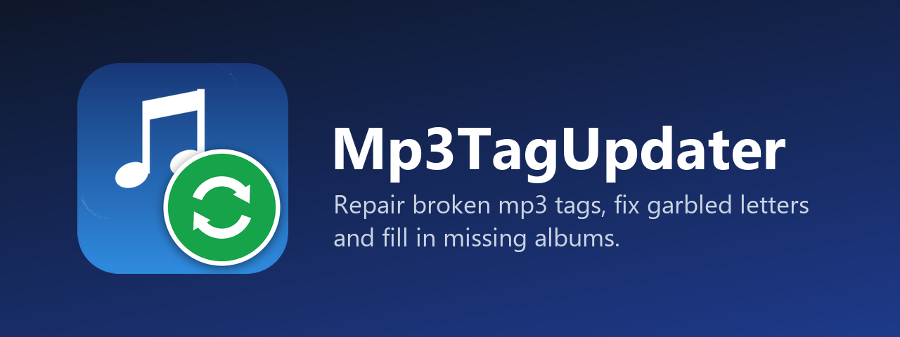

# Mp3TagUpdater

[](https://github.com/kreaton/Mp3TagUpdater/releases/latest)
[](LICENSE)




**Fix the mp3 files your player can't read, and give every song an album.**

Mp3TagUpdater checks a folder of `.mp3` files, repairs tag faults that make files unreadable, and fills in missing Album tags from the folder name. It can also correct Danish letters that show as two characters ("ø" for "ø"), read missing titles, artists and track numbers from file names such as "1-02 Artist - Title.mp3", and move the artist out of titles such as "Artist / Title".

- **Safe by default:** a scan only shows what would change. Nothing is written until you choose **Apply**.
- **Every file at a glance:** status, album, track, artist, title, length, and what would change or went wrong.
- **Full CSV log:** every file's details, tags and errors in a log that opens in a spreadsheet or loads into a database, including files that couldn't be read.

## Install

**[Download the installer](https://github.com/kreaton/Mp3TagUpdater/releases/latest/download/Mp3TagUpdater-win-Setup.exe)** and run it. If your PC doesn't have the .NET 10 Desktop Runtime yet, the installer adds it.

The installer isn't code-signed, so Windows may warn you about it. To continue, choose **More info → Run anyway**.

To get a newer version later, click the ⓘ button and choose **Check for updates**. To remove the app, use **Settings → Apps → Installed apps** in Windows.

## How to use it

1. Choose a **Folder** of mp3 files with **Browse...**, or drop a folder on the window.
2. Choose **Scan**. Every mp3 is read and listed, and nothing is changed. A changed album is shown as `→ Folder name`.
3. Check the list. **Show** narrows it to the files with changes, to only the `Updatable` files, or to errors and warnings. **Hide OK** leaves out the files with nothing to change and no problems, and **Search** finds a file by path, title, artist or album.
4. Choose **Apply N changes...** and confirm. The folder is read again and the changes are written.

**Cancel** stops after the current file. Double-click a file to open it in its default program, so an mp3 plays in your usual player. Drag files from the list into another program or a folder, as from Explorer; several selected files drag together, and they are copied, never moved. Right-click to show a file in Explorer or copy its path.

Untick **Include subfolders** to check only the top-level folder. Untick **Write CSV log** to skip the log. **Open log** opens the log of the last run. Tick **Fix æ, ø, å**, **Fix all file and folder names**, **Tags from file names** or **Album from folder name**, and choose **Split titles**, to use the options described below. A new value is shown as `→ value` in the list until it is applied.

The folder and the options are remembered for the next start, in `%APPDATA%\Mp3TagUpdater\settings.json`.

| Status | Meaning |
|---|---|
| `OK` | Read without problems |
| `Warning` | Readable, but possibly corrupt or containing no MPEG audio, such as a WAV named `.mp3` |
| `Repairable` | Unreadable, but **Apply** can repair it (the tags shown are from the verified repair) |
| `Repaired` | Was unreadable, and this run repaired it |
| `Updatable` | Readable, and **Apply** would change its tags or its name |
| `Updated` | This run changed its tags or its name |
| `Error` | Unreadable, with no automatic repair available |

## Repairing files

A file that can't be opened is checked for these faults:

| Fault | Repair |
|---|---|
| Empty `APIC` or `GEOB` frame (error: *A picture frame must contain at least 5 bytes*) | Remove the frame |
| Bad version byte such as `0x23` (error: *Unsupported tag version*), when the frames parse cleanly as v2.3 or v2.4 | Correct the version byte |
| Stated tag size runs past the padding into the first MPEG frame | Correct the stated size |

Each repair is verified in memory before anything is written. When applied, the file is replaced atomically, its modified time is kept, and the original is saved as `<name>.mp3.bak`. An existing `.bak` is never overwritten.

Files with any other fault are left alone and listed as `Error`.

## Filling in missing albums

A missing Album tag (empty or only whitespace) is set to the name of the folder directly containing the file. A file directly in the chosen folder therefore gets that folder's name. A file that is repaired in the same run can also get an album.

Tick **Album from folder name** to replace albums that are already set as well, for example after renaming a folder. Every file then gets the name of its folder as Album, and files whose album already matches are left alone.

Files with `Error` or `Warning` status are skipped, so tags are never rewritten on a file that may be damaged or not really an mp3.

All tag changes are saved to a temporary copy that is then swapped in, so a failed save can't damage the original. The modified time is kept, but no `.bak` is made.

## Tags from file names

**Tags from file names** fills in an empty Title, Artist, Track and Disc from the file name. Tags that are already set are never changed. These names are understood:

| File name | Disc | Track | Artist | Title |
|---|---|---|---|---|
| `1-02 Juan Maglio - Union Civica.mp3` | 1 | 2 | Juan Maglio | Union Civica |
| `02 Kim Larsen - Papirsklip.mp3`, `02 - Kim Larsen - Papirsklip.mp3` | | 2 | Kim Larsen | Papirsklip |
| `7. Papirsklip.mp3`, `12-Papirsklip.mp3` | | 7, 12 | | Papirsklip |
| `Kim Larsen - Papirsklip.mp3` | | | Kim Larsen | Papirsklip |
| `Papirsklip.mp3` | | | | Papirsklip |

The name is split at the first ` - `, so the artist comes first and a title may contain ` - ` itself. A name with the title first is read the wrong way round, so check the Artist and Title columns before applying.

A number followed only by a space, such as `50 Cent - In da Club`, counts as a track number only when most files in the folder start with a number. A leading zero (`05 `) or a `.` or `-` after the number always makes it a track number. A four-digit number such as `1999` is never a track number.

With **Fix æ, ø, å** or **Fix all file and folder names** ticked, the letters in the file name are corrected before it is read.

## Correcting æ, ø and å

Some rippers stored the letters as UTF-8 but marked them as Latin-1, so a player shows each one as two characters: `æ` for æ, `ø` for ø and `Ã¥` for å. **Fix æ, ø, å** corrects them in Title, Artist, Album, Album Artist and the file name. Other letters with the same fault are corrected too, such as ä, ö, é and ´.

In the capital letters Æ, Ø and Å (and Ä, Ö) the second character is often lost or turned into a space, as in `Mine à jne`. The letter is then looked up in the file name, so `Mine à jne` becomes `Mine Øjne` when the file is called `Mine Øjne De Skal Se.mp3`. If neither the file name nor the tags tell which letter it was, the text is left as it is and the file gets a note in the `Errors` column.

A file name is checked against the corrected tags. Where they spell a word differently, the tag wins, so `VÃœr vor gÃœst.mp3` is renamed to `Vær vor gæst.mp3` when that is the title. A file is never renamed over an existing file.

## Fixing all file and folder names

**Fix all file and folder names** goes further than the mp3 files: it renames every file and folder below the chosen folder whose name has garbled letters, such as covers, playlists and the album folders themselves. The chosen folder keeps its own name. It uses the same rules as the MojibakeFileFix command-line tool and recognises more kinds of damage than **Fix æ, ø, å**:

| Damaged name | Fixed | Letters were read as |
|---|---|---|
| `Søren Ã…rhus` | `Søren Århus` | Windows-1252 |
| `Don’t – stop` | `Don’t – stop` | Windows-1252 |
| `øl` (garbled twice) | `øl` | Windows-1252 |
| `├ª├╕├Ñ` | `æøå` | DOS 437 |
| `S├©ren` | `Søren` | DOS 850, common in files unpacked from zip archives |

Only characters that together form a real letter are changed, so correct names such as `Århus`, `São Paulo` or `CHÂTEAU` are left alone. A missing Album is filled in with the corrected folder name, so an mp3 in `Søren` gets the album `Søren`.

Some names are listed as `Warning` and not renamed:
- **Uncertain:** the only sign is one pair of characters that could also be correct, as in `MaÅ‚y` (Polish "Mały").
- **Lost letters:** a byte was lost, as in `Ã jne` for "Øjne", or a letter was replaced by `�`.

A folder's contents are renamed before the folder, and nothing is renamed over an existing file or folder. Folder links (junctions and symbolic links) are renamed but not entered. Files and folders that are renamed appear in the list and the log as their own rows, with a folder's name ending in `\`.

## Splitting "Artist / Title"

Many compilations put the artist in the title, as in `George Michael / Careless Whisper`, and set Artist to "Various". **Split titles** moves the artist to the Artist tag and leaves only the song in Title.

| Choice | Effect |
|---|---|
| **Off** | Titles are left as they are |
| **Automatic, per folder** | Works out for each folder whether the artist comes first or last. See below. |
| **Artist / Title** | The artist always comes first |
| **Title / Artist** | The artist always comes last |

A title is split at ` / `, or at a bare `/` when the title has no ` - ` (`Razz/Kickflipper`). In `Kasper Winding/Lars Muhl - Sjæl I Flammer` the `/` is part of the artist, so the title is left alone.

**Automatic** looks at every title in the scan for clues to which half is the artist:
- The half is a known artist: it's an Artist tag elsewhere, or the first part of an "Artist - Title" title.
- The same half appears in more than one title.
- The half reads like a Eurovision entry: `Charlotte Nilsson, Sverige - 1999`.
- The half joins names with `&`, `feat.` or a comma.

A half in parentheses or ending in `?` or `!` counts as the song. If the clues are even, the artist is taken to come first, which is the more common order. Check the Artist and Title columns after a scan, because a folder that mixes both orders gets some of them wrong.

## CSV log

Every run writes `mp3-log-YYYYMMDD-HHMMSS.csv` to the top of the chosen folder, scans included. It has one row per mp3, plus a row for each other file or folder that **Fix all file and folder names** renames or warns about.

- **Format:** RFC 4180, comma-separated, UTF-8 with BOM.
- **Values:** numbers are whole and dates are `yyyy-MM-dd HH:mm:ss`, so they don't depend on locale. A missing value is an empty cell.
- **Columns:** `Status`, `Errors`, `Changes`, `RelativePath`, `Directory`, `FileName`, `FullPath`, `SizeBytes`, `Created`, `Modified`, `Title`, `Artist`, `AlbumArtist`, `Album`, `Genre`, `Composer`, `Comment`, `Year`, `Track`, `TrackCount`, `Disc`, `Duration`, `DurationMs`, `BitrateKbps`, `SampleRateHz`, `Channels`, `TagTypes`, `PictureCount`, `Kind`.
- **Kind:** `mp3`, `file` or `folder`. It is the last column, so a log from before it was added still lines up.

The `Changes` column records which files were changed, or would be by a scan.

---

## For developers

| Project | What it is |
|---|---|
| `Mp3Tag.Core` | The DLL with all the logic: `new Mp3Library().Run(options, progress, cancellation)` and `Mp3CsvLog.Write`. [README](Mp3Tag.Core/README.md) |
| `Mp3Tag.Text` | Mojibake repair ("ø" → "ø"), shared by both apps. [README](Mp3Tag.Text/README.md) |
| `Mp3Tag.Albums` | Album lookup on Spotify and Discogs, track matching, and tagging and renaming a folder as one album. [README](Mp3Tag.Albums/README.md) |
| `Mp3TagUpdater.Wpf` | Windows GUI, `Mp3TagUpdaterWpf.exe` |
| `Mp3TagFromApi.Wpf` | Companion Windows GUI, `Mp3TagFromApi.exe`: tags one folder as an album from Spotify or Discogs (see below) |
| `Mp3Tag.Tests` | xUnit tests, which generate their own mp3 files |

The apps use [TagLibSharp](https://github.com/mono/taglib-sharp) to read and write tags. Installs and updates of Mp3TagUpdater use [Velopack](https://velopack.io).

### Mp3TagFromApi

A companion app with the same kind of list. It works on **one folder** at a time (one album), with no subfolders:

1. Choose or drop a folder. The search box starts with the folder name, with garbled letters fixed.
2. Pick **Spotify** or **Discogs** and choose **Search**. You can also paste an album or release URL. The first result is loaded. Each result is then compared with the folder, in the background:
   - green "✓ 12 tracks, 41:30 like the folder": the same number of tracks and about the same total playing time (within 2 %, at least 15 seconds);
   - "✓ 12 tracks, length not listed": the right number of tracks, but the source has no length for every track (often on Discogs);
   - orange "12 tracks, but 45:10 (folder 41:23)": probably another edition;
   - dimmed "9 tracks (folder 12)": can't be used for this folder.

   A line under the Album box sums it up, such as "3 of 10 albums have 12 tracks and about the same playing time as the folder".
3. The list shows each file's new title, artist, album, number and name with an arrow, in the same columns as Mp3TagUpdater. **Length** is the file's own playing time, measured from its audio. It is never changed.
4. To correct a value, select one or more files and press **F2** (or right-click, **Edit tags...**). The values you type take the place of the album's and are marked "(by hand)"; with an album, the file name follows the title and track. **Undo edits by hand** on the right-click menu brings back the album's values. Choosing another folder drops the edits.
5. **Apply** writes the tags (ID3v2.3) and renames the files to `NN - Title.mp3`. On compilations the names are `NN - Artist - Title.mp3`. Modified dates are kept. With **Save album JSON**, the source's album data is saved as `<album>.json` next to the files. The confirmation also offers to rename the folder to the album's name, made valid for Windows (`AC/DC` → `AC-DC`); you can change the name there or clear the tick. When the files already match the album, the button reads **Rename folder...**.

**Fix mojibake** corrects garbled letters ("ø" → "ø"). Without an album, that and your own edits are the only changes. **Scan** reads the folder again, for example after you changed the files in another program. Right-click a file for **Open the folder in Explorer**.

The ⚙ button opens the settings: the version, **Check for updates**, and the API keys. The Spotify client ID and secret and the Discogs personal access token are stored encrypted for your Windows user in `%APPDATA%\Mp3TagFromApi`; nothing is read from environment variables. **Import keys...** reads them from an `appsettings.secret.json`.

A search lists at most 10 albums from Spotify and 25 from Discogs. When it lists that many, a warning says there may be more: add words to the search, such as the year, or paste the album's URL.

Mp3TagFromApi is meant to ship as its own package, separate from the Mp3TagUpdater installer. `Mp3TagFromApi.Wpf\BuildRelease.ps1` builds and packs it with Velopack; add `-LocalOnly` to build without uploading. Releases go to the release-only repository `kreaton/Mp3TagFromApi`, so that the "latest release" link above keeps pointing at Mp3TagUpdater. Until the first release, build and run it from source:

```bash
dotnet run --project Mp3TagFromApi.Wpf
```

### Build and test

You need the [.NET 10 SDK](https://dotnet.microsoft.com/download).

```bash
dotnet build Mp3TagUpdater.slnx
```

```bash
dotnet test Mp3Tag.Tests
```

### Releases

Every push to `main` runs the tests, builds the app on GitHub Actions and publishes a new release, one patch version higher than the last (`.github/workflows/release.yml`). To push without releasing, add `[skip ci]` to the commit message. You can also start a release by hand from the repository's Actions tab, or run `Mp3TagUpdater.Wpf\BuildRelease.ps1` locally. Add `-LocalOnly` to build without uploading.

The repository must stay public, because **Check for updates** reads its releases without logging in.

## License & Authorship

This project is distributed under the terms of the [MIT License](LICENSE).

**AI authorship note:** Most of the source code in this repository was generated with AI coding agents (Claude Code), under my direction and review. Purely AI-generated material may not be eligible for copyright protection in some jurisdictions. To the extent any part of this project is protected by copyright, it is licensed under the MIT License, and the license's warranty and liability disclaimers apply to the project as a whole.

<!-- notices:start -->
### Independent development

Mp3TagUpdater is an independent, personal project developed by Per Hejndorf. It is not affiliated with, endorsed by or sponsored by Microsoft or any other rights holder. Product names and logos are trademarks of their respective owners and are used only to identify the services and tools the project works with.

### Third-party notices and asset provenance

[THIRD-PARTY-NOTICES.md](THIRD-PARTY-NOTICES.md) lists every third-party library, font and online service the project uses, with version, licence, source and whether it was modified. It also records where the icons, images, audio and video came from and how they are licensed.
<!-- notices:end -->
